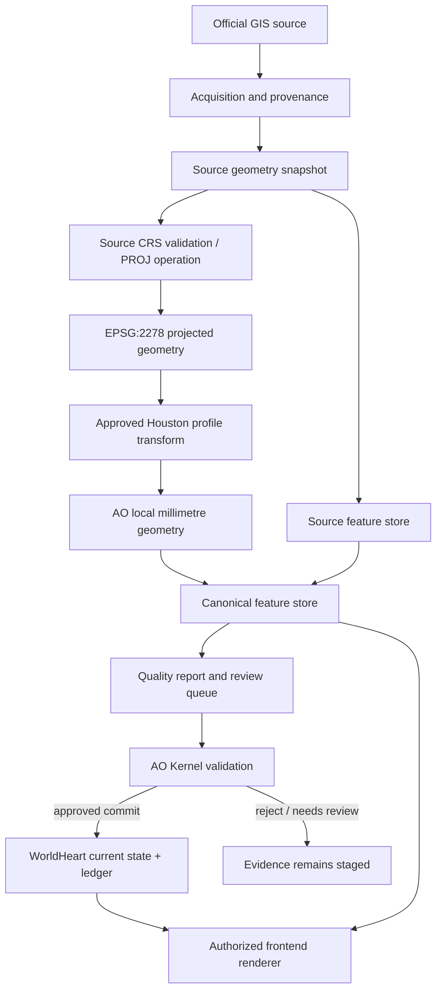

# Houston Spatial Profile and Geometry Store

**Implementation status:** first adapter/storage foundation, in review.
**Target:** isolated Houston staging geography.
**Not done:** no live GIS import, no Supabase migration application, no live-world change, and no frontend-to-WorldHeart integration.

## 1. Why these pieces exist

PR #18 established the Houston spatial design: one metric AO coordinate frame, 1 m surface cells, 1 mm fixed-point subunits, 64 m chunks, vector geometry retained as source/canonical evidence, and Kernel authority over world-state changes.

This implementation turns that design into a small, testable foundation without changing the existing AO runtime's coordinate constants.

The design keeps three coordinate/data concepts separate:

- **S2 identity:** global spherical hierarchy and stable Earth-cell identity.
- **GIS source geometry:** the exact geometry and attributes supplied by a publisher, in that source's CRS.
- **AO local geometry:** projected geometry expressed in the Houston AO local engineering frame, in integer millimetres.

The S2 registry does not replace local building/road geometry. Conversely, a local AO coordinate does not replace the stable global S2 identity.

## 2. Chosen working CRS and what remains open

The profile records EPSG:2278, NAD83 / Texas South Central (US survey feet), as the candidate Houston working projected CRS because the City of Houston COH_RoadCenterline source inspected for the road-network work reports EPSG:2278.

The unit conversion is exact:

\[
1\text{ US survey foot}=\frac{1200}{3937}\text{ metres}
\]

The profile is deliberately **draft**. It does not invent:
- an AO origin (projected Easting/Northing);
- a vertical CRS or vertical datum;
- a source-to-working-CRS operation for each incoming dataset;
- a horizontal accuracy budget.

The road-centerline source already uses the candidate working CRS, but other datasets may not. Their source CRS must be recorded and transformed using a separately reviewed PROJ operation before the local AO transform is applied.

Millimetre integer storage is resolution, not a claim that the source survey is accurate to one millimetre.

## 3. Coordinate conversion contract

Let:
- \(E,N\) be projected Easting and Northing in the working CRS;
- \(E_0,N_0\) be the configured AO origin in the same CRS and units;
- \(u=1200/3937\) metres per US survey foot;
- \(S=1000\) AO millimetres per metre.

Then:

\[
X_{mm}=round_{away}((E-E_0)\cdot u\cdot S)
\]

\[
Y_{mm}=round_{away}(-(N-N_0)\cdot u\cdot S)
\]

GIS Northing increases north. AO Y increases south. Therefore the Northing delta is negated. Positive Easting delta becomes positive AO X.

The inverse is:

\[
E=E_0+\frac{X_{mm}}{uS},\qquad
N=N_0-\frac{Y_{mm}}{uS}
\]

Rounding is Decimal half-away-from-zero. The Python adapter rejects binary floating-point input to avoid accidental language-dependent rounding. Coordinates must be supplied as Decimal, string or integer.

### Important boundary

`geography/adapter/coords.py` converts coordinates that are **already in EPSG:2278**. It is not a projection engine. A source in EPSG:4326 or another CRS must first pass through an explicitly selected, versioned projection/datum operation. Z is not transformed because the profile has no approved vertical reference.

## 4. Component map

| Component | Input | Output | Responsibility |
|---|---|---|---|
| Source adapter | GIS response + source metadata | Immutable acquisition snapshot | Fetch, paginate, checksum, retain source attributes |
| CRS operation | Source coordinates + source CRS | EPSG:2278 projected geometry | Explicit datum/projection transformation; not implemented in this phase |
| Coordinate adapter | EPSG:2278 coordinates + approved profile | AO integer millimetres | Origin shift, axis sign, unit conversion and deterministic rounding |
| Source feature store | Original geometry + attributes | Versioned source feature record | Provenance and raw evidence |
| Canonical feature store | Transformed geometry + profile version | AO local vector geometry | Typed feature candidate and spatial indexes |
| AO Kernel | Candidate evidence + world rules/permissions | Approved world-state event or rejection | Authority for canonical world truth |
| WorldHeart | Approved Kernel commit | Current state + append-only history | Persistent world state and committed history |
| Frontend renderer | Authorized view + spatial geometry | Map/scene/tactical presentation | Render only; no authority to commit world changes |

### End-to-end data journey



The diagram shows the intended complete pipeline. In this phase, the coordinate utility and database migration are present, but acquisition, PROJ integration, Kernel handoff, WorldHeart writes and renderer integration are not implemented.

## 5. Database model

The migration creates a separate `ao_spatial` schema. The existing proposed S2 registry uses `ao_geo`; do not merge these namespaces.

### Tables

- `spatial_profiles`: immutable-by-version coordinate contracts. Origin, CRS, unit, axes, scale, rounding, transform metadata and approval record are explicit.
- `source_datasets`: publisher, URL/layer, licence, version, source CRS, coverage and retrieval metadata.
- `import_runs`: one reproducible acquisition/validation attempt, with snapshot checksum, target area, counts and validation report.
- `source_features`: append-only raw source feature snapshots, source geometry, raw attributes, source identity and geometry status.
- `canonical_features`: normalized geometry in AO local millimetre coordinates (PostGIS SRID 0), linked to source feature and profile version, with feature type/status and transform provenance.

Both source and canonical geometries receive GiST indexes. Source and canonical geometry are not the same column: source geometry keeps its source CRS/SRID; canonical geometry is local AO engineering space and must not be mislabeled as EPSG:2278 or WGS84.

The source feature table rejects UPDATE and DELETE. A changed upstream feature is captured by a new import run. Canonical features are profile-versioned and retain derivation metadata.

**There is deliberately no world-entity table in this migration.** GIS evidence is not automatically a player, building entity, ownership record, accessible route or canonical world fact.

### Access boundary

The migration is written for Supabase roles:
- `service_role` receives trusted backend access.
- `anon` and `authenticated` receive no schema/table grants.
- RLS is enabled and forced on all tables.
- Never expose the service-role key to the browser or commit it to the repository.
- Keep `ao_spatial` out of the PostgREST exposed-schema list unless a later security review explicitly authorizes a narrow API.

The SQL has not been applied to a Supabase project. PostGIS extension availability and migration behavior must be confirmed in a disposable database before any project is changed.

## 6. Coordinate adapter walkthrough

The adapter has no third-party Python dependency.

Example after a profile has been approved and loaded:

```python
from decimal import Decimal
from geography.adapter.coords import (
    ProjectedCoordinate,
    load_profile,
    projected_to_ao,
    ao_to_projected,
)

profile = load_profile("geography/profiles/houston-v1.json")
# The committed profile is intentionally draft and will raise until
# its origin and approval record have been filled through the review process.

projected = ProjectedCoordinate(
    easting=Decimal("..."),
    northing=Decimal("..."),
)
ao_point = projected_to_ao(projected, profile)
restored = ao_to_projected(ao_point, profile)
```

Do not replace the ellipses with guessed Houston origin coordinates. The selected origin belongs in a new, reviewed profile version. The committed v1 profile remains a draft template until then.

Sparse addressing helpers use mathematical floor division, including negative coordinates:
- cell index = floor(AO millimetres / cell size in millimetres);
- chunk index = floor(cell index / 64).

This ensures coordinates west/north of the origin receive stable negative cell/chunk indices.

## 7. Run the tests

From the repository root with Python 3.10+:

```bash
python -m unittest discover -s tests -v
```

The tests cover:
- origin maps to (0, 0);
- east is +X and north is -Y;
- exact US survey foot conversion;
- deterministic half-away-from-zero rounding;
- round-trip quantization error no greater than 0.5 mm per horizontal axis;
- rejection of binary floats;
- rejection of draft/unconfigured profiles;
- negative cell/chunk floor behavior.

These are unit tests for the coordinate contract. They do not test a live PostGIS server, a PROJ installation, GIS acquisition, or a production AO runtime.

## 8. Frontend and backend responsibilities

**Backend / ingestion**
1. Reads a registered source dataset.
2. Acquires bounded pages/tiles and records a raw checksum.
3. validates source CRS and geometry.
4. Transforms into the profile working CRS.
5. Applies the approved local AO transform.
6. Writes source and canonical geometry through trusted backend credentials.
7. Generates quality reports and queues candidates for Kernel review.

**Kernel / WorldHeart**
1. Kernel evaluates candidate features, permissions, conflicts and world rules.
2. Only approved changes become committed world events.
3. WorldHeart updates derived current state and preserves append-only history.
4. AI narration receives only the authorized state/view and may not invent hidden facts.

**Frontend**
1. Requests authorized regional/street/interior views.
2. Renders source/canonical geometry and approved world entities as distinct visual layers.
3. Uses the same AO coordinate frame at every zoom level.
4. Sends player intent to the Kernel; it never writes canonical state directly.

The existing globe/S2 UI is not yet connected to this new storage layer. A future map client should consume a narrow backend view/API rather than connect directly to PostGIS.

## 9. Verification and release gates

Before the profile can be approved:
- select an origin from a documented, stable Houston reference;
- record full CRS WKT/identifier and coordinate operation;
- verify EPSG:2278 source metadata and unit definitions for each dataset;
- select and document a vertical datum before importing Z;
- establish a source accuracy budget;
- independently verify transform round trips against PROJ/known control points;
- review the SQL migration in a disposable Supabase/PostgreSQL database with PostGIS;
- test RLS and role grants as anon, authenticated and service_role;
- prove append-only source snapshot behavior;
- run a small bounded staging import and compare geometry before/after transform.

Only after those gates should an importer or renderer be connected. No existing world coordinates or live world data should be migrated as part of this Houston staging phase.

## 10. Rollback

This phase is isolated on a feature branch. Closing the PR leaves `main`, Supabase and the live world unchanged. If a future staging database applies the migration, rollback must be a reviewed forward migration or a disposable-project reset; do not casually drop evidence tables or source snapshots.
